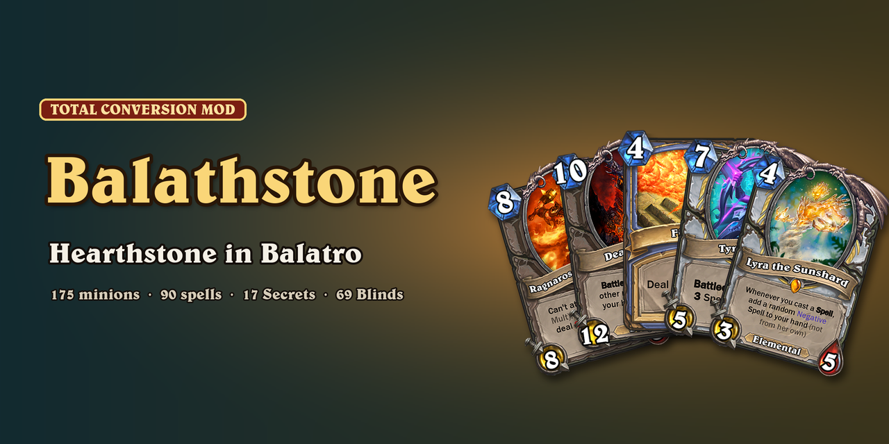
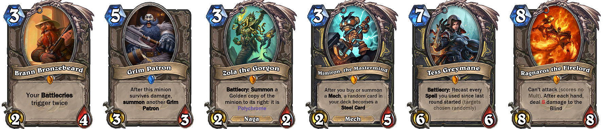
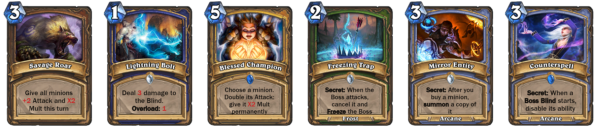
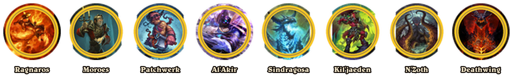

# Balathstone

A Hearthstone total conversion mod for Balatro. Jokers, consumables, tags and Blinds are replaced with Hearthstone cards.

## Minions

175 minions replace Jokers. Attack scores Mult, Health scores Chips. Battlecry, Deathrattle, Taunt, Divine Shield, Windfury and the rest work as keywords, and combos stack X Mult.



## Spells and Secrets

90 Spells, Locations and Forbidden Spells buff minions, damage the Blind and edit your deck. 17 Secrets replace tags and trigger mid-round. 32 Treasures replace vouchers.



## Bosses

69 Blinds are Hearthstone minions and bosses that attack your board every hand, with Charge, Stealth, Lifesteal, Reborn, summoned armies and more.



Full rules: [docs/DESIGN.md](docs/DESIGN.md)

## Install

1. Install [Lovely](https://github.com/ethangreen-dev/lovely-injector) and [Steamodded](https://github.com/Steamodded/smods).
2. Put this folder in `%APPDATA%/Balatro/Mods/Balathstone`.
3. Launch Balatro.

## Development

```
pip install lupa pillow numpy
python tests/run_tests.py     # headless test suite
python tools/build_art.py     # rebuild card atlases
```

Fan-made, unofficial and free. Not affiliated with Blizzard Entertainment or LocalThunk.
Code is MIT. Hearthstone art, names and text © Blizzard Entertainment; fonts © their owners. See [LICENSE](LICENSE).
