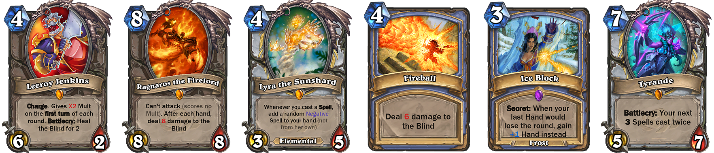

# Balathstone

Hearthstone, rebuilt as a Balatro mod. Jokers, consumables, tags and Blinds are replaced with Hearthstone cards.



- **175 minions.** Attack scores Mult, Health scores Chips. Battlecry, Deathrattle, Taunt, Divine Shield, Windfury and the rest work as keywords.
- **90 Spells, Locations and Forbidden Spells** that buff minions, damage the Blind and edit your deck.
- **17 Secrets** replace tags and trigger mid-round.
- **69 Blinds** are Hearthstone minions and bosses that attack your board every hand.
- **32 Treasures** replace vouchers.

Rules: [docs/DESIGN.md](docs/DESIGN.md)

## Install

1. Install [Lovely](https://github.com/ethangreen-dev/lovely-injector) and [Steamodded](https://github.com/Steamodded/smods).
2. Put this folder in `%APPDATA%/Balatro/Mods/Balathstone`.
3. Launch Balatro.

## Development

```
pip install lupa pillow numpy
python tests/run_tests.py     # headless test suite
python tools/build_art.py     # rebuild card atlases
```

Fan-made, unofficial and free. Not affiliated with Blizzard Entertainment or LocalThunk.
Code is MIT. Hearthstone art, names and text © Blizzard Entertainment; fonts © their owners. See [LICENSE](LICENSE).
